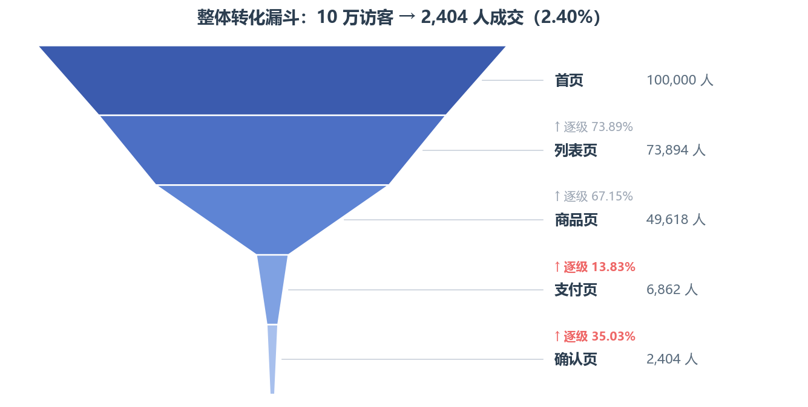
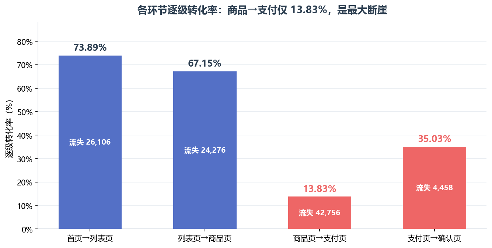
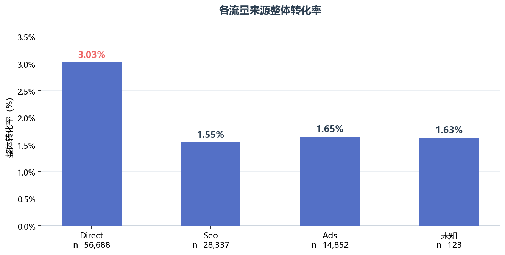
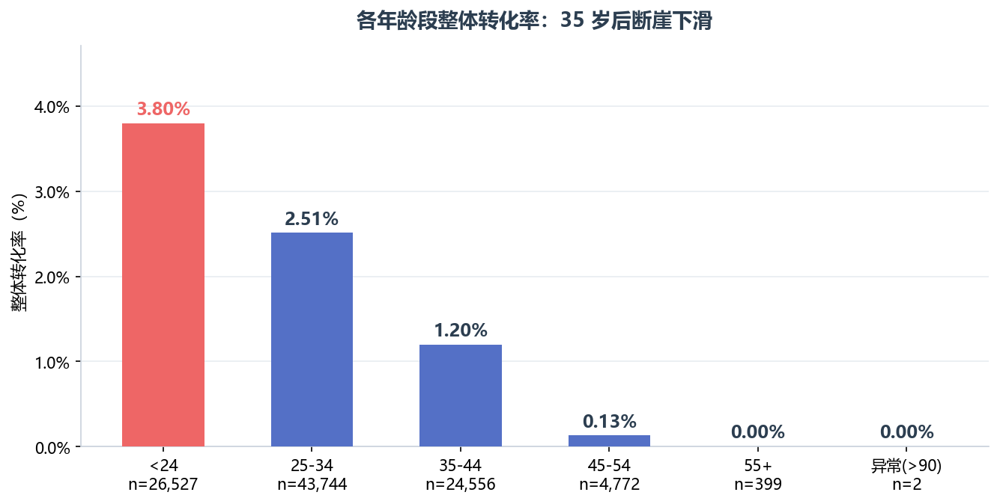

# 电商网站转化漏斗分析

对某电商网站 **10 万名访客**的访问与转化数据做全链路漏斗分析：定位流失环节、拆分人群与渠道差异、用统计检验确认差异是否真实，并测算各环节的优化空间，最终给出**按投入产出排序**的行动建议。

---

## 一、业务背景

网站整体转化率偏低。需要回答两个问题：

1. **用户在购买路径的哪一环流失最多？**（诊断）
2. **该优先修复哪一个环节？**（决策）

第 1 个问题靠漏斗与维度拆解回答；第 2 个问题不能只看"流失人数"，要用**可量化增益**来排序——这是本项目与普通漏斗报告的核心区别。

---

## 二、数据集与字段

原始数据：`user_behavior.csv`，**100,000 行**，无缺失值。

| 字段 | 含义 | 说明 |
|---|---|---|
| `new_user` | 是否新用户 | **1 = 新客，0 = 老客** |
| `age` | 年龄 | 含少量 >90 的异常值（2 行），清洗时置空 |
| `sex` | 性别 | Female / Male / `0`（未填写） |
| `market` | 市场级别 | 1–4 |
| `device` | 设备 | mobile / desktop / `0` |
| `operative_system` | 操作系统 | windows / iOS / android / mac / other / linux / `0` |
| `source` | 流量来源 | Direct / Seo / Ads / `0` |
| `total_pages_visited` | 浏览页面总数 | 1–28 |
| `home_page` | 是否到达首页 | 0/1，全部为 1 |
| `listing_page` | 是否到达列表页 | 0/1 |
| `product_page` | 是否到达商品页 | 0/1 |
| `payment_page` | 是否到达支付页 | 0/1 |
| `confirmation_page` | 是否到达确认页（成交） | 0/1 |

> 字段取值中的字符串 `'0'` 表示"未填写"，在清洗层统一替换为「未知」；
> 五个页面字段为**累计到达标记**（每一步的人都必须出现在上一步），漏斗即按此定义。

---

## 三、项目结构

```
funnel_analysis/
├── funnel_analysis.ipynb   # 主分析 notebook（全部分析与结论）
├── init_db.py              # 一键初始化数据库并导入数据
├── requirements.txt        # Python 依赖
├── .env.example            # 环境变量模板（复制为 .env 后填写）
├── .gitignore
├── images/                 # 关键图表（README 引用；notebook 用 pyecharts，图在 GitHub 上看不到，故导出 png）
└── data/
    └── user_behavior.csv   # 原始数据（自行放入此目录）
```

---

## 四、快速开始

### 1. 准备环境

```bash
pip install -r requirements.txt
```

需要本机已安装 **MySQL 5.7+ / 8.0**（本项目在 MySQL 上验证）。

### 2. 配置数据库连接

```bash
copy .env.example .env        # Windows
cp   .env.example .env        # Mac / Linux
```

打开 `.env`，填入自己的 MySQL 账号密码：

```
DB_USER=root
DB_PASSWORD=你的密码
DB_HOST=127.0.0.1
DB_PORT=3306
DB_NAME_FUNNEL=funnel_analysis
```

> `.env` 已被 `.gitignore` 忽略，不会提交到仓库。
> 变量名用 `DB_NAME_FUNNEL` 而非 `DB_NAME`，是为了和另一个项目（电商 RFM 分析，库名 `order_analysis`）在同一终端里互不覆盖。

### 3. 初始化数据

把 `user_behavior.csv` 放进 `data/` 目录，然后：

```bash
python init_db.py
```

脚本会自动完成：建库 → 建表 `user_behavior` → 导入 CSV → 校验行数。

- 指定其他路径：`python init_db.py --csv "D:/path/to/user_behavior.csv"`
- 重建重导：`python init_db.py --drop`
- 重复运行是安全的（幂等）

### 4. 运行分析

打开 `funnel_analysis.ipynb`，**从上到下依次运行**即可。

---

## 五、分析框架

1. **漏斗前提校验** —— 确认不存在跳步（走到了下一步的人必然出现在上一步）
2. **数据清洗** —— 建视图 `v_behavior`，统一处理 `'0'` 缺失值、年龄异常值
3. **整体漏斗** —— 各层人数、逐级转化率、累计转化率
4. **分维度转化** —— 新老客 / 来源 / 设备 / 系统 / 市场 / 性别 / 年龄 / 浏览深度
5. **显著性检验** —— 两比例 Z 检验，标注差异是否统计显著
6. **交叉分析** —— 性别 × 新老客，检验两个效应是否独立
7. **优化空间测算（杠杆）** —— 量化各环节的可达增益，排优先级
8. **结论与建议、数据局限**

---

## 六、关键结论

**整体漏斗（10 万 → 2,404 人成交，整体转化率 2.4%）**



各层逐级转化率——注意**商品页→支付页仅 13.83%** 的断崖：



| 环节 | 到达人数 | 逐级转化率 |
|---|---|---|
| 首页 → 列表页 | 100,000 → 73,894 | 73.89% |
| 列表页 → 商品页 | 73,894 → 49,618 | 67.15% |
| 商品页 → 支付页 | 49,618 → 6,862 | **13.83%** |
| 支付页 → 确认页 | 6,862 → 2,404 | **35.03%** |

**核心判断：优先级是「支付→确认」，不是流失人数最多的「商品→支付」。**

| 环节 | 流失人数 | 内部最优组已达 | 可达空间 |
|---|---|---|---|
| 商品→支付 | 42,756 | 16.36%（<24 岁） | 仅 +2.5pp |
| **支付→确认** | 4,458 | **46.38%**（<24 岁） | **+11.4pp** |

- 商品→支付流失人数虽多，但数据内部最好的组也只做到 16.36%，**可达空间只有 2.5pp**；
- 支付→确认流失人数少，但内部最优组已达 46.38%，**有 11pp 空间**，且该环节流失的是已过 4 道关的最高意向人群，多属支付流程/体验障碍，修复成本低、见效快。
- 按「单位投入的可达增益」排序：支付→确认提到内部最优可 **+32.4%**，商品→支付只能 **+18.3%**。

**人群与渠道洞察**

按流量来源拆解整体转化率：



按年龄拆解，可见明显的「35 岁断崖」：



- 新老客在支付→确认分化最剧：老客 38.57% vs 新客 25.31%（差 13.26pp）；
- 女性整体转化 3.02%，约为男性 1.45% 的 2 倍（两比例 Z 检验极显著）；
- 年龄呈「35 岁断崖」：<24 岁 3.80% 最高，35 岁以上断崖下滑；
- 高价值人群叠加：**老客女性**贡献 62% 的成交，运营应直接瞄准交叉象限，而非把维度当独立机会分别投放。

---

## 七、方法论要点

- **漏斗前提校验**：先验证数据满足严格漏斗（无跳步）再做分析，避免"分母不干净"。
- **两比例 Z 检验**：每个维度组与「剔除自身后的大盘」对比，输出 z 值与 p 值，并用中文标注显著性，避免用样本量堆出来的"假差异"下结论。
- **杠杆锚点取自数据内部**：优化目标不主观臆断（不是"提到 50%"），而是取**数据中已经实现过的最优组水平**作为可比基准，并给出乐观/中性/悲观三档敏感性。
- **诚实的局限声明**：主动说明锚点的结构差异、两个杠杆不可相加、小样本组不作结论等，把结论的边界讲清楚。

---

## 八、数据局限

- 数据为**用户级聚合**，无访问时间戳，无法做时序、留存与访问时长分析；
- 无订单金额与成本字段，无法计算 GMV 与广告 ROI，仅能以转化率评估；
- `total_pages_visited` 与页面到达标记存在 **0.59%（589 行）** 的不一致（页数小于到达步数），但该差异只出现在未成交人群（2–4 步），不涉及成交口径；漏斗建立在页面标记之上，故不影响本报告结论；
- 公开教学数据集，结论用于方法论验证，具体收益需在真实业务数据上复测。

---

## 九、常见问题

- **报错 `ObjectNotExecutableError` / SQLAlchemy 2.x 相关**：本项目 notebook 中有未经 `text()` 包装的裸 SQL（建视图），因此 `requirements.txt` 锁定 `SQLAlchemy>=1.4,<2.0`。若要升级到 2.x，需把 `conn.execute(sql_view)` 改为 `conn.execute(text(sql_view))`。
- **`new_user` 谁是 1？** 参见字段表：**1 = 新客**（原数据集字段说明为"是否新用户，是:1、否:0"）。
- **`'0'` 是什么？** 表示该属性未填写，统一归为「未知」，不参与结论解读。
